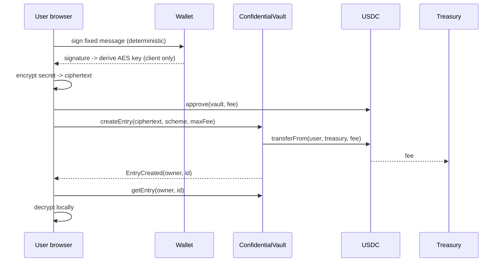

# ConfidentialVault Design Doc

## Metadata

- Status: Draft (awaiting owner confirmation)
- Target chain: Arc Testnet (USDC is the fee token, ERC-20 view, 6 decimals)
- Language / toolchain: Solidity 0.8.28, Foundry, OpenZeppelin 5.x
- Contract: `contracts/ConfidentialVault.sol` (immutable, no proxy)
- Review tracker
  - [ ] Design review
  - [ ] Security review (contract review + static analysis + unit tests)

## Action Items (living)

- None yet.

## Goals / Non-Goals

Goals
- Let any address store encrypted blobs ("entries") onchain, retrievable only by the entry owner's address.
- Charge a flat USDC fee per new entry, paid directly to a treasury address.
- Let owners update and delete their own entries at any time.
- Keep the contract holding no funds at rest.

Non-Goals
- The contract never encrypts, decrypts, or sees keys. All cryptography runs in the user's browser.
- No onchain access control over reads: chain state is public, so confidentiality comes only from client-side encryption.
- No sharing or delegated access (owner-only vault).
- No upgradeability, no subscriptions, no refunds, no permit-based fee payment (v1 uses approve then create).
- No key recovery. If a user cannot reproduce their key, the data is unrecoverable.

## Requirements

Functional
- F1. `createEntry` stores ciphertext (1 to 4096 bytes) under `(msg.sender, id)` and pulls the current fee in USDC from the caller to the treasury.
- F2. `updateEntry` replaces ciphertext of the caller's own existing entry. No fee.
- F3. `deleteEntry` removes the caller's own entry. Always allowed, even when paused. No refund.
- F4. Owner may change the fee (hard cap 1 USDC), change the treasury, and pause/unpause.
- F5. Anyone may read entries (they are ciphertext). Reads are free.

Security (testable assertions)
- S1. No address other than the entry owner can create, update, or delete that owner's entries.
- S2. The vault's USDC balance is always 0.
- S3. Fee charged never exceeds the caller's `maxFee` argument and never exceeds `MAX_FEE` (1 USDC).
- S4. A failed fee transfer reverts the whole create (no free entries).
- S5. Pause blocks create and update only. Delete is never blocked.
- S6. Ownership cannot be renounced or transferred in one step.
- S7. Treasury can never be set to the zero address.

## Terminology & Actors

- Entry: `{ciphertext, scheme, createdAt, updatedAt}` stored per `(owner, id)`.
- Scheme: client-defined tag (for example `1` = AES-GCM, key derived from a wallet signature over a fixed message). Lets clients migrate formats later.
- Treasury: address that receives fees.

| Actor | On/off-chain | Trust | Can do |
| --- | --- | --- | --- |
| User | onchain EOA | untrusted | create/update/delete own entries, pay fee |
| Owner | onchain | trusted | set fee (<= 1 USDC), set treasury, pause/unpause, start ownership transfer |
| Treasury | onchain | n/a | receives USDC fees, no privileges |
| Observer | anyone | untrusted | read all ciphertext (public) |
| Browser client | off-chain | semi-trusted by its user | derive key, encrypt, decrypt |

## Language / Runtime

- Solidity 0.8.28 (checked arithmetic), Cancun EVM per project config.
- OpenZeppelin: `Ownable2Step`, `Pausable`, `ReentrancyGuard`, `SafeERC20`.

## Transaction & Execution Model

Each call is atomic. The only external call is the USDC `transferFrom` inside `createEntry`. Effects (store entry, bump counter) happen before the call (CEI) and `nonReentrant` guards it. If USDC reverts, the entry is rolled back.

## Chain Standards & Interfaces

- ERC-20 (USDC) via `SafeERC20`. On Arc, USDC is also the native gas asset, but this contract only uses the ERC-20 view (6 decimals). The contract never accepts native value (no `receive`, no payable functions).
- Owner-style roles map: `owner` (fee, treasury, pause). No separate pauser, blocklister, or rescuer (see Tradeoffs).

## Architecture Overview



Flow of funds

| Step | Who moves what | Invariant |
| --- | --- | --- |
| createEntry | user -> treasury, `fee` USDC, routed by vault via `transferFrom` | vault never holds balance; amount <= maxFee and <= 1 USDC |
| update / delete | none | no funds move |

Resting-state invariant: vault USDC balance == 0.

Dependencies: USDC token contract (immutable address, set at deploy). Assumption: wallets sign deterministically (EOAs). Smart-contract wallets and non-deterministic signers are not supported by the reference client scheme.

## Contract Design

Roles

| Role | Holder | Permissions | Why |
| --- | --- | --- | --- |
| owner | one address (Ownable2Step) | setFee, setTreasury, pause, unpause, start transfer | minimal admin surface |
| pending owner | one address | acceptOwnership | two-step transfer |

Storage

- `IERC20 immutable usdc`
- `uint256 constant MAX_FEE = 1_000_000` (1 USDC)
- `uint256 constant MAX_CIPHERTEXT = 4096`
- `uint256 public fee`
- `address public treasury`
- `mapping(address => uint256) public entryCount` (next id per user)
- `mapping(address => mapping(uint256 => Entry)) entries`
- `struct Entry { bytes ciphertext; uint64 createdAt; uint64 updatedAt; uint8 scheme; }`

Modifiers: `whenNotPaused`, `onlyOwner`, `nonReentrant`.

Write functions

| Function | Access | State mutated | Events | Reverts |
| --- | --- | --- | --- | --- |
| `createEntry(bytes ciphertext, uint8 scheme, uint256 maxFee) returns (uint256 id)` | anyone, not paused | entries, entryCount; USDC moved user->treasury | `EntryCreated(owner,id,scheme,fee)` | paused, empty or > 4096 bytes, `fee > maxFee`, USDC transfer fails/insufficient allowance |
| `updateEntry(uint256 id, bytes ciphertext, uint8 scheme)` | entry owner, not paused | entry ciphertext, scheme, updatedAt | `EntryUpdated(owner,id,scheme)` | paused, entry missing, empty or > 4096 bytes |
| `deleteEntry(uint256 id)` | entry owner, always | deletes entry | `EntryDeleted(owner,id)` | entry missing |
| `setFee(uint256 newFee)` | owner | fee | `FeeUpdated(old,new)` | `newFee > MAX_FEE` |
| `setTreasury(address t)` | owner | treasury | `TreasuryUpdated(old,new)` | zero address |
| `pause()` / `unpause()` | owner | paused | OZ `Paused` / `Unpaused` | OZ rules |
| `transferOwnership` / `acceptOwnership` | owner / pending | owner | OZ events | OZ rules |
| `renounceOwnership()` | nobody | none | none | always reverts |

Pseudocode for createEntry

```
require(!paused)
len = ciphertext.length; require(len > 0 && len <= MAX_CIPHERTEXT)
f = fee; require(f <= maxFee)
id = entryCount[msg.sender]++
entries[msg.sender][id] = Entry(ciphertext, now, now, scheme)
emit EntryCreated(...)
if (f > 0) usdc.safeTransferFrom(msg.sender, treasury, f)   // nonReentrant
```

Read functions: `getEntry(address owner, uint256 id) returns (Entry)`, `entryCount(address)`, `fee()`, `treasury()`, `usdc()`, `MAX_FEE()`.

Events: `EntryCreated(address indexed owner, uint256 indexed id, uint8 scheme, uint256 feePaid)`, `EntryUpdated`, `EntryDeleted`, `FeeUpdated`, `TreasuryUpdated`. Indexed owner and id let clients list a user's entries from logs.

## Specification summary

Principles: only the owner mutates own entries; vault holds no funds; fee bounded; delete always works.

## Deployment & Initialization

- Constructor args: `usdc` (Arc Testnet USDC ERC-20 address from the project's chain facts), `initialOwner` (your wallet), `treasury` (your wallet, changeable), `initialFee` (10000 = 0.01 USDC).
- Constructor reverts on zero usdc, zero owner, zero treasury, or fee above cap. A zero fee is valid.
- Genesis roles: owner = the address you provide; treasury = same address by default.
- Balance left post-deploy: 0.

## Upgradeability

None (immutable). Migration story: deploy a new vault at a new address, users read old entries from the old contract and re-create in the new one (decrypted and re-encrypted client side). Entries are never lost because the old contract keeps working (unless paused, where reads and deletes still work).

## Key Management & Signing

- Contract: no signatures verified. The owner key is a single EOA, so use a hardware wallet or multisig for real use.
- Client: the encryption key is derived from the user's wallet signature over a fixed, versioned message (`personal_sign`, domain-separated by contract address and chain ID so signatures are not reusable elsewhere). The signature must never be sent anywhere or stored. Reference client keeps the key in memory only.

## Security Considerations

| Vulnerability | Applicable? | Mitigation |
| --- | --- | --- |
| Reentrancy | Yes (USDC call) | CEI + `nonReentrant` |
| Access control | Yes | per-user mapping keyed by `msg.sender`; `onlyOwner` for admin |
| Integer overflow | Checked 0.8 | no `unchecked` |
| Unchecked external call | Yes | `SafeERC20` |
| Fee-on-transfer / rebasing | No | fee goes straight to treasury; vault holds nothing |
| Signature replay | N/A onchain | none verified in contract |
| Front-running / MEV | Fee changes | `maxFee` argument lets the user bound the fee |
| Oracle / flash loan | N/A | none used |
| DoS | Low | no loops, bounded size, delete not pausable |
| Delegatecall / proxy | N/A | immutable |
| Timestamp | Informational | only used for metadata |
| Approval persistence | Yes | UI should approve exactly the fee, not unlimited |
| Centralization | Yes | owner can change fee (<= 1 USDC), treasury, pause; cannot read, alter, or delete entries |
| Data publicity | Yes | everything is public ciphertext; mitigated by client-side encryption; ciphertext length, timing, and owner address are visible |
| Harvest-now-decrypt-later | Yes | weak passphrase/key derivation would expose data forever; use wallet-signature key with strong KDF |
| USDC blocklist | Yes | blocklisted treasury breaks creation; owner can re-point treasury |

## Trust Model & Threat Analysis

| Actor | Worst case if compromised | Mitigation | Detection |
| --- | --- | --- | --- |
| Owner key | raise fee to 1 USDC, redirect fees, pause create/update | hard cap 1 USDC, `maxFee` on create, delete never pausable, two-step transfer, no way to touch user data | `FeeUpdated`, `TreasuryUpdated`, `Paused` events |
| User wallet key | attacker derives the user's key and decrypts and edits all entries | inherent to wallet-derived keys; user rotates by re-encrypting under a new address | n/a |
| Treasury | none (receives only) | n/a | n/a |

## Emergency Response & Circuit Breakers

Owner can pause create/update. Delete and reads stay available so users can always remove data. No rescue function: the vault never holds tokens or native coin, and it rejects native value. Tokens sent to it by mistake are not recoverable (accepted).

## Failure Scenarios

- USDC `transferFrom` reverts (no allowance, blocklisted): whole create reverts, entry rolled back.
- Fee raised between signing and mining: create reverts with the fee-above-max error.
- Paused: create/update revert, delete works.
- Treasury blocklisted by USDC: creates revert until owner sets a new treasury.

## Priorities & Tradeoffs

| Decision | Tradeoff | Rationale / rejected |
| --- | --- | --- |
| Fee only on create | updates are free, so cost is bounded only by gas | matches "pay per stored entry"; rejected per-update fee |
| Pull fee straight to treasury | requires prior approve | vault holds no funds, no withdraw function to attack; rejected escrow-and-withdraw |
| Single owner for fee, treasury, pause | wider blast radius than split roles | you chose a single owner; bounded by fee cap and by pause not touching delete |
| Immutable | no bug fixes in place | simplest and safest; migration path above |
| 4 KB cap | large files impossible | bounds gas and state bloat; store file hashes or pointers for larger data |
| Public view of ciphertext | metadata is visible | unavoidable onchain; no labels stored, to avoid leaking plaintext metadata |

## Testing Strategy

- Foundry unit tests: create/update/delete happy paths, access separation between users, fee math, `maxFee` guard, cap on size, pause behavior (delete still works), two-step ownership, renounce reverts, treasury zero-address, USDC failure rolls back.
- Fuzz: fee and sizes within and beyond limits, arbitrary callers.
- Invariants: vault USDC balance == 0; `entryCount` only increases; fee <= 1 USDC.
- Static analysis with Slither; full pre-deploy rehearsal on a fork of Arc Testnet.
- Run: `forge test`.

## Third-party libraries

| Lib | Version | Existing dependency | Why | Reviewed |
| --- | --- | --- | --- | --- |
| @openzeppelin/contracts | project pin | yes | audited Ownable2Step, Pausable, ReentrancyGuard, SafeERC20 | widely audited |

## Monitoring & Alerting

| Event | Threshold | Severity |
| --- | --- | --- |
| `FeeUpdated` | any | medium |
| `TreasuryUpdated` | any | high |
| `Paused` | any | high |
| `OwnershipTransferStarted` | any | high |

## Cross-Functional Stakeholders

Contract owner (you) approves parameters; client developer owns the encryption scheme.

## Worked Example

1. User signs the fixed message, derives key `K`, encrypts "my seed note" into ciphertext `C`.
2. User approves the vault for 0.01 USDC.
3. `createEntry(C, 1, 10000)`: entry id 0 stored, 0.01 USDC moves user -> treasury, `EntryCreated` emitted.
4. Later, user reads `getEntry(user, 0)`, re-signs the same message to re-derive `K`, decrypts `C` locally.
5. `deleteEntry(0)` removes it.
